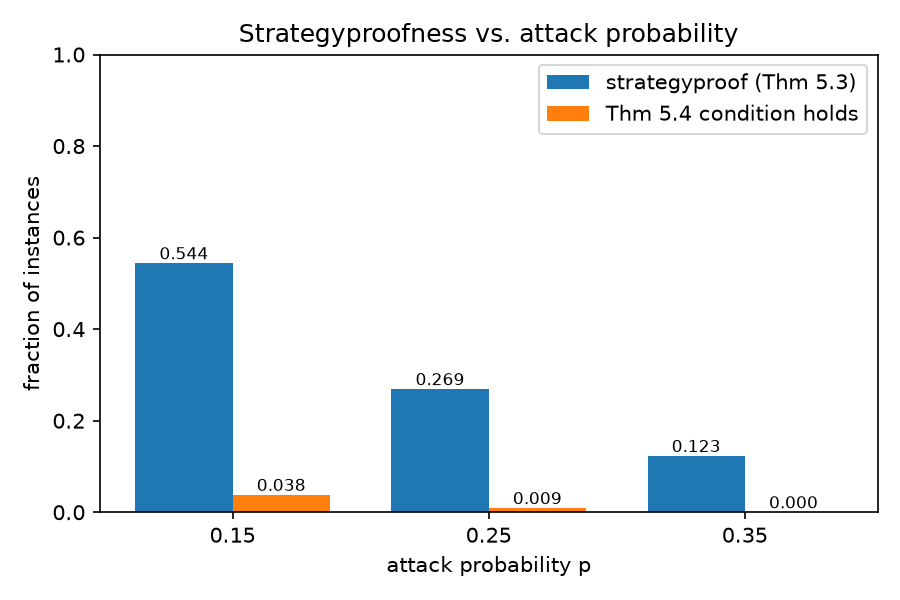

All definitions are taken from Rahwan, *Argumentation among Agents*, Chapter 5.
Code is in `argframe/`, tests in `tests/`, and experiment scripts in `experiments/`.

# Part 1: Argumentation Engine

| Task | Function |
|---|---|
| 1. Framework ⟨A, ⇀⟩ | `ArgumentationFramework(arguments, attacks)` |
| 2. Conflict-free | `af.is_conflict_free(S)` |
| 3. S defends a | `af.defends(S, a)` |
| 4. Characteristic function F(S) | `af.characteristic(S)` |
| 5. Admissible / complete | `af.is_admissible(S)`, `af.is_complete(S)` |
| 6A. Grounded extension | `grounded_extension(af)` (iterates F from ∅) |
| 6B. Complete extensions | `complete_extensions(af)` |
| 6C. Preferred, stable, semi-stable | `preferred_extensions`, `stable_extensions`, `semi_stable_extensions` |
| 6D. Legal labellings | `legal_labellings(af)` |
| 6E. Acceptance status | `acceptance_status(af, a, semantics)` |

## Testing on the book examples

**Figure 5.1** (α2⇀α1, α3⇀α2, α4⇀α1, α5⇀α4)

- S = {α3, α5} is conflict-free and admissible, F(S) = {α1, α3, α5}, so S is not complete.
- {α1, α3} is not admissible (α4 attacks α1 and is not counter-attacked).
- Grounded: ∅ → {α3, α5} → {α1, α3, α5}. This is also the only complete, preferred, stable and semi-stable extension.
- One legal labelling: α1, α3, α5 = in; α2, α4 = out.
- α1, α3, α5 are skeptically accepted; α2, α4 are rejected.

**Figure 5.2** (α1⇄α2, α3 unattacked)

- Grounded: {α3}.
- Complete: {α3}, {α1, α3}, {α2, α3}.
- Preferred = stable = semi-stable: {α1, α3}, {α2, α3}.
- Three legal labellings (α1/α2 = undec/undec, in/out, out/in, α3 always in).
- Under preferred semantics α3 is skeptically accepted, α1 and α2 are credulously accepted. Under grounded semantics α1 and α2 are rejected.

**Figure 5.3(i)**: grounded trace ∅ → {e} → {c, e} → {a, c, e}, matching the book.

Some extra cases were also checked: 3-cycle (no stable extension), self-attacking argument, 4-cycle (two preferred extensions), a framework where preferred ≠ semi-stable, and the empty framework. Complete extensions and labellings were also compared against brute force on random frameworks. All 52 tests pass.

# Part 2: Strategic Argumentation

| Task | Function |
|---|---|
| 1. Mechanism | `grounded_mechanism(attacks, reports)` |
| 2. Best responses | `best_responses(attacks, types, i, reports)` |
| 3. Theorem 5.3 check | `satisfies_theorem_5_3(attacks, types)` |
| 4. Theorem 5.4 condition | `theorem_5_4_condition(attacks, types)` |

The mechanism takes the union of revealed arguments, restricts the attack relation to it, and returns the grounded extension. Utility of agent i is |A_i ∩ outcome|.

The Theorem 5.3 check is exhaustive: for every agent and every combination of subsets revealed by the other agents, it checks whether revealing all of A_i is a best response.

For Theorem 5.4, the condition fails if some agent has α, β ∈ A_i with an odd-length path α ↪ β in the full graph (an attack inside A_i is a path of length 1). To handle cycles, the search is a BFS over (argument, parity of path length) pairs. Each state is visited once, so it terminates even when the graph has cycles, and odd paths that go around a cycle are also found.

## Book examples

**Example 5.10**: A_x = {α1, α4, α5}, A_y = {α2}, A_z = {α3}. Truthful outcome is {α1, α3}, so u_x = 1. If x hides α1, the outcome is {α2, α4, α5} and u_x = 2. So x's best response is {α4, α5} and the mechanism is not strategyproof. The condition of Theorem 5.4 also fails (α1 → α2 → α3 → α4).

**Example 5.11**: adding α6 ⇀ α3 with α6 ∈ A_x. Now the outcome is {α1, α4, α5, α6} whatever x hides, so it is strategyproof, even though the odd path α1 → α2 → α3 → α4 still exists.

**Misprints found:**

1. Example 5.10: the book swaps u_y and u_z. With A_y = {α2}, A_z = {α3} and outcome {α1, α3}, the correct values are u_y = 0 and u_z = 1.
2. After Example 5.11: the argument that cancels the indirect self-defeat is α6, not α5. α6 is unattacked and attacks α3, so α3 can never be accepted.

# Experiments

Setup: 3 agents, n ∈ {6, 7, 8} arguments, each ordered pair (self-attacks included) is an attack with probability p ∈ {0.15, 0.25, 0.35}, and arguments are split at random among the agents (each agent gets at least one). 1000 instances per p, 3000 in total, seed 42.

## 1. Fraction of strategyproof instances

| p | Instances | Strategyproof | Fraction | Thm 5.4 condition holds |
|---|---|---|---|---|
| 0.15 | 1000 | 544 | 0.544 | 38 |
| 0.25 | 1000 | 269 | 0.269 | 9 |
| 0.35 | 1000 | 123 | 0.123 | 0 |
| Total | 3000 | 936 | 0.312 | 47 |

{ width=60% }

As p increases there are more attack chains between arguments of the same agent, so there are more chances for an agent to gain by hiding, and the fraction drops.

## 2. Condition holds but not strategyproof

| p | Cond. holds, SP | Cond. holds, not SP | Cond. fails, SP | Cond. fails, not SP |
|---|---|---|---|---|
| 0.15 | 38 | 0 | 506 | 456 |
| 0.25 | 9 | 0 | 260 | 731 |
| 0.35 | 0 | 0 | 123 | 877 |
| Total | 47 | 0 | 889 | 2064 |

There are **no** such instances. This matches Theorem 5.4: the condition is sufficient for strategyproofness, so whenever it holds the mechanism must be strategyproof. All 47 instances where the condition holds were confirmed strategyproof by the exhaustive check, which is a separate piece of code from the path search.

## 3. Strategyproof although the condition fails

There are **889** such instances (506, 260 and 123 for the three values of p). So the condition is not necessary, which is also what Example 5.11 shows.

- **884 instances** fail the condition only because of a direct attack between two arguments of the same agent (or a self-attack). Hiding the attacker frees the attacked argument but loses the attacker itself, so the agent gains nothing.
  - p = 0.15, #158: only attack a2 ⇀ a6, both owned by x. Hiding a2 gets a6 accepted but loses a2, so u_x stays 3.
  - p = 0.15, #9: a3 ⇀ a5 and a5 ⇀ a5, both owned by x. a5 attacks itself so it is never accepted, and hiding a3 only loses a3.
- **5 instances** have only an indirect odd path. In these, the same agent also has an even path to the target (it defends its own argument), so the two effects cancel.
  - p = 0.25, #804: A_z = {a1, a6}, attacks a2⇀a1, a4⇀a2, a4⇀a3, a6⇀a2, a6⇀a4. The path a6 → a4 → a2 → a1 is odd, but a6 also attacks a2 directly. Truthful u_z = 2. If z hides a6, a4 comes in but a4 still attacks a2, so a1 stays accepted and z just loses a6 (u_z = 1).
- Among the 889 instances, 5 have a cancelling argument like α6 in Example 5.11: an unattacked argument of the agent that keeps the middle argument out no matter what is hidden.

The full list of these instances is in `results/q2_q3_examples.md`.
